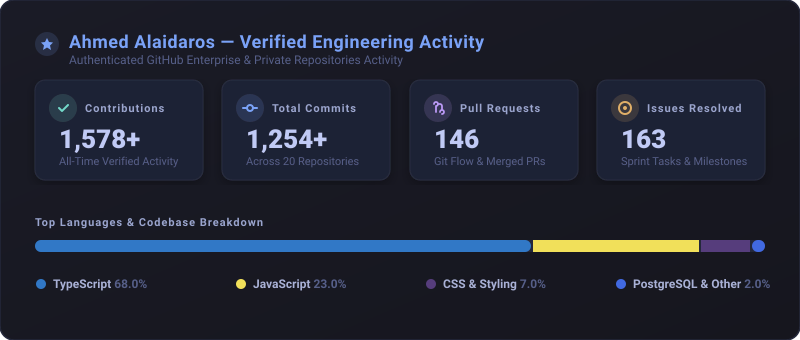

  <h1>Hi there, I'm Ahmed Alaidaros 👋</h1>
  
<strong>Full-Stack Software Engineer | Enterprise Web & Cloud Architectures</strong>

---

### 🚀 About Me
- 💻 Architecting scalable, end-to-end type-safe systems with **Next.js**, **NestJS**, and **PostgreSQL**.
- 🏗️ Deep passion for Clean Architecture, Modular Monorepos, and Domain-Driven Design (DDD).
- 🗄️ End-to-end data modeling, schema design, and database migrations with **Prisma**.
- 🧪 Heavy advocate of automated testing and end-to-end reliability with **Playwright**.

---

### 🛠️ Core Tech Stack

#### 🌐 Frontend Development

#### ⚙️ Backend & Architecture

#### 🗄️ Database & Modeling

#### 🧰 Tools & Engineering Quality

---

### 📈 Verified GitHub Engineering Activity

  

